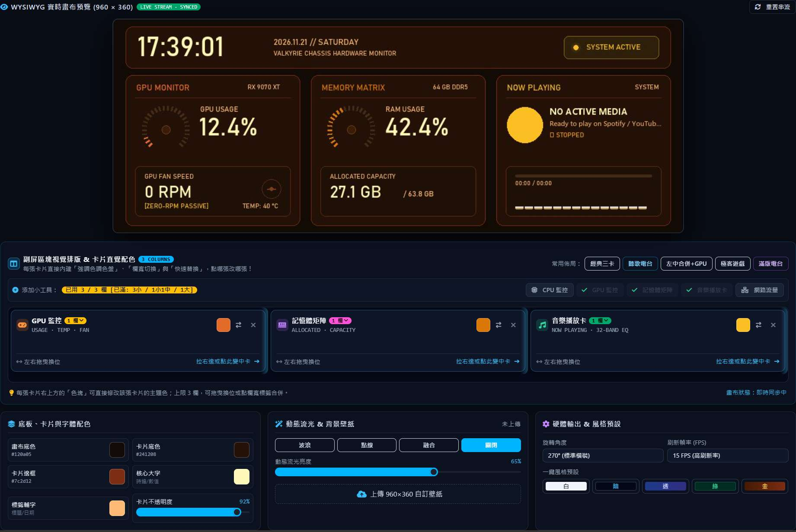
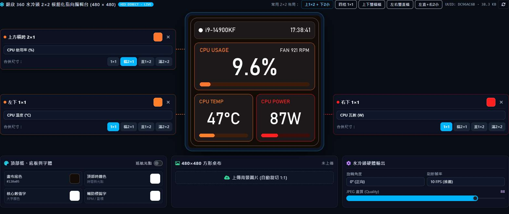

# VK03M & SilverStone E360MAX Dual Display Studio

> **本專案基於開源專案 [hogancv/valkyrie-240-lcd](https://github.com/hogancv/valkyrie-240-lcd) 修改與擴展製作**，完整支援 **瓦爾基里（Valkyrie）VK03M 機箱副屏（物理 360×960 / 橫向 960×360，MS9132，VIC=160）** 與 **銀欣（SilverStone）E360MAX 水冷頭方形副屏（480×480，HWCX HID）** 雙螢幕同步即時推流，並內建滿版無側邊欄的 **Web 視覺化雙屏編輯台（Web Studio）**、模組化儀表板、中文音樂播放卡片、Windows 11 CPU 溫度／瓦數感測器整合，以及開機靜默管理員自啟動腳本。

---

## 介面實機預覽

### 1. 瓦爾基里 VK03M 機箱副屏（`960×360` 模組化視覺編輯台）


### 2. 銀欣 E360MAX 水冷頭副屏（`480×480` 2×2 模組化指向編輯台）


---

## 核心特色

- **雙螢幕同時推流與獨立控制（`http://localhost:5050`）**：
  - **Tab 1 — 機箱副屏 `960×360`（MS9132）**：
    - 修正 `valkyrie_lcd/protocol.py` 幀頭 `frame_header()` 為標準 12-bit 封裝（`FF 00 00 00 00 16 83 C0`），實機點亮 VK03M 機箱長條副屏（`VIC=160`，YUV422）。
    - 支援 **3 欄 GridStack 模組化卡片排版**（CPU、GPU、記憶體、網路流量、音樂播放卡），卡片內直接內嵌顏色選擇器，可自由切換 1 欄（小卡）／2 欄（中卡）／3 欄（滿版大卡）與常用佈局預設。
    - 內建針對 15 FPS 最佳化的 **實體動態背景流光（柔和平滑波浪 / 科技點線 / 雙重融合）** 與背景桌布上傳（含霧化與壓暗調整）。
    - **中文歌曲完整顯示**：音樂卡片自動載入系統微軟正黑體（`msyhbd.ttc` / `msyh.ttc`）並依像素寬度精準截斷，徹底解決中文歌名／歌手亂碼與出框問題。
  - **Tab 2 — 銀欣 E360MAX 水冷頭 `480×480`（HWCX HID）**：
    - 透過原生 Windows HID（`VID=0145 / PID=3002`，搭配 `LcdComm.dll`）直接推流 480×480 JPEG（Quality 90 單幀約 14 ms，無需更換 `libusb` 驅動）。
    - 頂部固定保留 **CPU 型號與即時時鐘**，下方為 **動態 `2×2` 模組化網格**，支援 `1×1`、`橫 2×1`、`直 1×2`、`滿 2×2` 自由合併，並提供 5 組一鍵預設佈局。
    - **左右指向式編輯台**：左右編輯卡依各區塊實際座標（上排／下排）自動對齊並以虛線指向對應區塊，每個區塊可獨立選擇監控指標（CPU 使用率／溫度／瓦數、GPU 使用率／溫度、RAM 使用率、時間）與獨立邊框／進度條顏色。
    - 支援 `480×480` 方形桌布自動裁切上傳、旋轉角度、刷新率與 JPEG 畫質調整。
- **滿版高可讀性介面**：
  - 移除傳統右側邊欄，採用最大 `1840px` 滿版寬度配置與放大字體／控制元件，大螢幕下編輯直覺無死角。
  - 即時 MJPEG 網頁預覽與實體螢幕同步；關閉瀏覽器分頁時自動跳過網頁端 JPEG 壓縮以節省 CPU。
- **Windows 11 CPU 溫度與瓦數感測器**：
  - 除 `LibreHardwareMonitorLib.dll` 外，整合經 WHQL 數位簽章的 `HardwareHelp64.dll`（`CPUIDHardware`）作為備援來源，在 Windows 11 開啟核心隔離（HVCI）／Defender 保護時仍可穩定讀取 CPU 溫度（`°C`）與封裝瓦數（`W`）。
- **低資源佔用、穩定性保護與開機靜默自啟動**：
  - **Windows 媒體卡片按需休眠**：透過 Windows GSMTC 抓取 Spotify / 瀏覽器歌曲資訊與封面；當畫面上沒有放置音樂卡片時，後台輪詢完全休眠，避免喚醒 `NPSMSvc` 佔用 CPU。
  - **官方軟體防碰撞與重連冷卻**：推流前自動偵測 `MythCool.exe` 是否在背景運行，避免搶佔 USB 介面導致 MS9132 鎖死；斷線時具備 2.5 秒重連冷卻。
  - **開機免 UAC 靜默管理員啟動**：提供 `install_autostart.bat` 一鍵建立 Windows 工作排程（`RunLevel Highest` + `pythonw.exe`），開機即以管理員權限於背景啟動雙屏推流，無黑框、免每次確認 UAC。

---

## 支援硬體規格

| 裝置 | 物理規格 | 通訊方式 | 驅動需求 | 狀態 |
|---|---|---|---|---|
| **瓦爾基里 VK03M 機箱副屏** | 360×960（橫置 960×360，VIC=160，YUV422） | `VID_345F / PID_9132`<br>`MI_00` HID + `MI_03` Bulk | `MI_03` 需綁定 `libusb-win32` | ✅ 實機驗證 + Web Studio 完整支援 |
| **銀欣 E360MAX 水冷頭副屏** | 480×480 正方形（JPEG 串流） | `VID_0145 / PID_3002`<br>標準 Windows HID | 免換驅動（需搭配 `LcdComm.dll`） | ✅ 實機驗證 + Web Studio 完整雙屏整合 |
| **瓦爾基里 240×240 水冷副屏** | 240×240（VIC=156，YUV422） | `VID_345F / PID_9132` | 同 VK03M | ✅ 繼承上游原版完整支援 |

---

## 快速開始（Windows）

### 1. 前置條件
1. 安裝 Python 3.10+（本專案於 Python 3.12 驗證）。
2. **VK03M / MS9132 機箱副屏**：
   - 使用 [Zadig](https://zadig.akeo.ie/) 將 `VID_345F / PID_9132` 的 `MI_03` 介面綁定為 **`libusb-win32`**（非 WinUSB）。
   - **完全退出官方 Myth.Cool 軟體**（建議取消開機自啟，避免搶佔 `MI_00` / `MI_03`）。
3. **銀欣 E360MAX 水冷頭副屏 & CPU 感測器**：
   - 安裝銀欣官方軟體（ICENODE）並退出其背景常駐程式以避免搶佔 HID；程式會自動搜尋常見安裝路徑（`C:\Program Files\ICENODE`、`C:\ICENODE`、`D:\ICENODE`、`tools\icenode`），也可透過環境變數 `ICENODE_DIR` 手動指定。
   - 若需讀取 GPU 溫度／風扇轉速等進階硬體感測器，可將 `LibreHardwareMonitorLib.dll` 放於 `tools/lhm/` 或 `tools/lib/`。
4. 安裝相依套件：
   ```bash
   pip install -r requirements.txt
   ```

### 2. 環境自檢
```bash
python tools/doctor.py
```

### 3. 啟動雙屏 Web Studio

#### 方式 A：設定開機靜默自啟動（推薦）
對專案根目錄的 [`install_autostart.bat`](install_autostart.bat) 按右鍵選擇 **「以系統管理員身分執行」**：
- 自動建立 Windows 工作排程 `ValkyrieDisplayStudio`（最高管理員權限、`pythonw.exe` 背景靜默執行），並立即啟動服務。
- 日後開機自動執行雙屏推流，不再跳出 UAC 視窗與終端機黑框；執行日誌會記錄於 `web_editor/studio.log`。
- 如需移除自啟動，以系統管理員身分執行 [`uninstall_autostart.bat`](uninstall_autostart.bat) 即可。

#### 方式 B：手動啟動
雙擊 [`run_studio.bat`](run_studio.bat)（建議以系統管理員身分執行以取得完整 CPU 溫度／瓦數感測器權限），或於終端機執行：
```bash
python web_editor/app.py
```

啟動後開啟瀏覽器前往：**`http://localhost:5050`** 即可同時管理機箱副屏與水冷頭副屏。

### 4. 其他獨立範例與測試腳本
```bash
# 瓦爾基里 360x960 機箱副屏獨立科幻 HUD 測試
python examples/scifi_hud_960x360.py

# 銀欣 480x480 水冷頭點亮測試
python examples/test_silverstone_480x480.py

# 銀欣 480x480 JPEG 體積與傳輸速度階梯實測
python examples/test_silverstone_limit.py

# 協議層單元測試（不接硬體也可執行）
python -m unittest discover -s tests -v
```

---

## 專案目錄結構

```text
├── valkyrie_lcd/                  # MS9132 雙通道驅動與協議核心（改自 hogancv/valkyrie-240-lcd）
├── web_editor/                    # 雙屏 Web Studio 視覺化編輯器與推流後端
│   ├── app.py                     # Flask 伺服器、雙屏推流排程、MythCool 防碰撞保護
│   ├── renderer.py                # 960x360 機箱副屏 HUD 卡片、中文音樂卡與動態流光引擎
│   ├── aio_driver.py              # 銀欣 E360MAX 480x480 水冷頭原生 HID 驅動（封裝 LcdComm.dll）
│   ├── aio_renderer.py            # 銀欣 E360MAX 480x480 頂部時鐘條 + 動態 2×2 模組化渲染引擎
│   ├── media_manager.py           # Windows GSMTC 媒體播放監控（支援自動休眠節能）
│   ├── config/
│   │   ├── theme.json             # 機箱副屏（960x360）主題、FPS、旋轉角度與卡片佈局設定
│   │   └── aio_theme.json         # 水冷頭（480x480）2×2 區塊配置、配色與硬體輸出設定
│   └── templates/index.html       # 滿版無側邊欄雙屏指向式視覺化編輯介面
├── examples/                      # 各尺寸副屏獨立範例、硬體感測器封裝與銀欣測試腳本
├── tools/doctor.py                # USB / HID / libusb0 環境自檢工具
├── install_autostart.bat          # Windows 開機靜默管理員自啟動安裝腳本（工作排程）
├── uninstall_autostart.bat        # 移除開機自啟動腳本
├── run_studio.bat                 # Windows 手動啟動 Web Studio
├── fix_usb.bat                    # MS9132 異常卡死時的系統管理員 USB 重設輔助腳本
├── docs/                          # 上游協議說明（PROTOCOL.md）與實機踩坑記錄（PITFALLS.md）
└── tests/                         # 協議常量與渲染單元測試
```

---

## ⚠️ MS9132 硬體注意事項（必讀）

- **絕對不要對 MS9132 裝置呼叫 `usb.core.Device.reset()`**：該晶片收到 USB Bus Reset 會導致韌體鎖死，裝置管理員出現 `USB\VID_0000&PID_0005`（裝置描述元要求失敗）。本專案所有程式皆不呼叫 `reset()`。
- 若因睡眠喚醒或線材接觸不穩導致 `VID_0000` 錯誤，請先嘗試以**系統管理員身分**執行 [`fix_usb.bat`](fix_usb.bat)；若系統提示需重啟或仍無法恢復，請**徹底關機並切斷主機電源線／電源供應器開關 30 秒放電**後再開機。
- 更多底層細節請參考 [docs/PITFALLS.md](docs/PITFALLS.md) 與 [docs/PROTOCOL.md](docs/PROTOCOL.md)。

---

## 致謝與原專案來源

本專案核心 MS9132 驅動協議修改自以下開源貢獻：

- **[hogancv/valkyrie-240-lcd](https://github.com/hogancv/valkyrie-240-lcd)**（MIT）—— 本專案的原始基礎倉庫，提供完整驗證過的 MS9132 協議與雙通道推流框架
- **[itsmylife44/LcdFusion](https://github.com/itsmylife44/LcdFusion)**（MIT）—— 76 條 HID 初始化序列的原始出處
- **[rhgndf/ms912x](https://github.com/rhgndf/ms912x)** / [tiirwaa/ms912x](https://github.com/tiirwaa/ms912x) / [MolinStepan/ms912x](https://github.com/MolinStepan/ms912x) —— MS912x 橋接晶片幀結構與像素格式常量
- **[AFSFerreira/ms91xx-linux-drm](https://github.com/AFSFerreira/ms91xx-linux-drm)** —— MacroSilicon 官方 GPL 原始碼與暫存器定義
- **[ZGMFX01A/MythCool-Lite issue #1](https://github.com/ZGMFX01A/MythCool-Lite/issues/1)** —— 官方日誌路徑與 `MI_03` 使用 `libusb-win32` 關鍵線索

## 免責聲明

非官方專案，與瓦爾基里（Valkyrie）／Myth.Cool／MacroSilicon／銀欣（SilverStone）無關。直接驅動硬體螢幕請自行承擔風險，採用 MIT License 授權。
